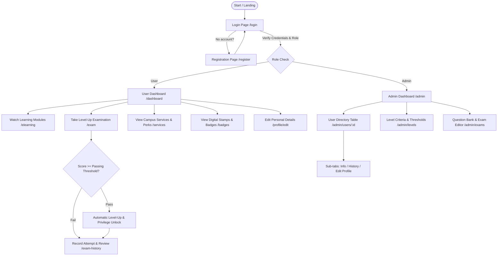

# AIPass (AI Passport) - Frontend

[](https://vuejs.org/)
[](https://vite.dev/)
[](https://www.typescriptlang.org/)
[](https://tailwindcss.com/)
[](https://pinia.vuejs.org/)
[](https://vercel.com/)

> **Course:** 953331 Component-Based Software Development  
> **Project:** Project 2 - Frontend Web Application (Group 14)  
> **Academic Year:** 2026  
> **Institution:** College of Arts, Media and Technology (CAMT), Chiang Mai University

---

## Team Members

| Student ID | Full Name | Primary Roles & Responsibilities |
| :---: | :--- | :--- |
| **** | Contributor | Frontend Architecture, Admin Portal, Exam & Criteria Management |
| **** | Contributor | User Dashboard, E-Learning, Examination & Level Progression |
| **** | Contributor | Auth System, Shared Components, Global Styling & Responsive UI |

---

## Project Overview

**AIPass (What's AI Passport)** is a digital passport and competency certification platform designed for students and faculty members at the College of Arts, Media and Technology (CAMT), Chiang Mai University. Built following **Component-Based Software Development (CBSD)** principles, the application provides role-separated interfaces for **General Users (Students/Members)** and **System Administrators**.

The platform is structured around a **4-Tier Skill Progression System**:
1. **Level 1 - Explorer:** Foundational tier for new members, introducing core digital knowledge, university workflows, and basic digital tools (Passing score: 70%).
2. **Level 2 - Achiever:** Intermediate tier for students who have developed specialized domain skills and can apply digital tools to build real-world projects (Passing score: 75%).
3. **Level 3 - Innovator:** Advanced tier for students creating innovative tech solutions with potential for national competitions and startup incubation (Passing score: 80%).
4. **Level 4 - Master:** Highest tier of CAMT Passport, recognizing outstanding academic, professional, and international expertise (Passing score: 85%).

---

## Key Features & Modules

### 1. User Portal
* **Authentication & Registration:**
  * Mock login authentication via email or username identifier.
  * User registration supporting dual Thai and English names and provincial selection.
* **Profile & Passport Dashboard (`/dashboard`):**
  * Displays current tier (Level Badge), active status, and personal details.
  * Real-time progress tracker and unlocked university privileges overview.
  * Quick access shortcuts to E-Learning, Level-up Exams, and Attempt History.
* **Profile Management (`/profile/edit`):**
  * Self-service profile updates (Thai and English first/last names, residential province).
* **E-Learning Modules (`/dashboard/elearning`):**
  * Curated video course catalog tailored for each skill level to prepare candidates for examination.
* **Interactive Leveling Examination (`/dashboard/exam`):**
  * Multiple-choice assessment engine with real-time scoring.
  * Evaluates responses against dynamically configured passing criteria for the target level.
  * **Automatic Level-Up:** Upon passing, the student's passport level is instantly upgraded.
* **Exam History (`/dashboard/exam-history`):**
  * Comprehensive attempt log with timestamps, scores achieved, and pass/fail indicators.
* **Services & Privileges (`/dashboard/services`):**
  * Level-dependent university perks (CAMT Equipment Pool, 3D Printing Lab quota, high-performance GPU cluster access, Smart Meeting room booking).
* **Badges & Achievements (`/dashboard/badges`):**
  * Visual gallery of earned digital stamps and certification badges.

### 🛠️ 2. Admin Portal
* **Admin Dashboard (`/admin`):**
  * Executive KPI metric cards (Total Users, Active/Inactive Ratio, Level distribution counts).
  * Paginated user directory with real-time search and multi-filtering by Level and Province.
  * Instant status toggling (Active / Inactive switch).
* **User Management & Detail View (`/admin/users/:id`):**
  * **Tab 1 - Info:** Comprehensive personal and academic profile data.
  * **Tab 2 - History:** Complete historical record of examinations taken by the user.
  * **Tab 3 - Edit:** Full administrative editing capability, including manual level overrides.
* **Level Criteria Management (`/admin/levels`):**
  * Overview of all four competency tiers and their associated campus privileges.
  * Live threshold configuration to adjust passing score percentages.
* **Question Bank & Exam Management (`/admin/exams`):**
  * Question bank management for progression tiers (Level 1➔2, Level 2➔3, Level 3➔4).
  * Question builder supporting choice editing, correct answer selection, and real-time preview cards.

### 3. Security, Routing & UX
* **Route Guards & RBAC:**
  * Guest-only guard for Login/Register routes.
  * User authentication guard for protected dashboard features.
  * Strict Admin guard ensuring unauthorized users cannot access management interfaces.
  * **NProgress Loading Bar:** Smooth visual feedback on route changes.
* **Error Resilience:**
  * Custom 404 (Not Found), 500 (Internal Server Error), and Network Offline status views.
* **Institutional Pages:**
  * Dedicated pages for Privacy Policy, Terms of Service, and Help & Support.

---

## System Workflow



---

## Tech Stack & Architecture

| Category | Technology | Description |
| :--- | :--- | :--- |
| **Core Framework** | [Vue 3](https://vuejs.org/) (v3.5+) | Reactive component model using Composition API (`<script setup lang="ts">`) |
| **Language** | [TypeScript](https://www.typescriptlang.org/) (v6.0+) | Strict static type checking across all data contracts and component props |
| **Build Tool** | [Vite](https://vite.dev/) (v8.1+) | High-performance build tool with instant Hot Module Replacement (HMR) |
| **Routing** | [Vue Router](https://router.vuejs.org/) (v5.2+) | Client-side routing, nested routes, and navigation guards with RBAC |
| **State Management** | [Pinia](https://pinia.vuejs.org/) (v4.0+) | Centralized, reactive state stores (`authStore`, `examStore`, `levelStore`) |
| **Styling** | [Tailwind CSS](https://tailwindcss.com/) (v4.3+) | Modern utility-first styling integrated via `@tailwindcss/vite` |
| **UX Enhancements** | [NProgress](https://ricostacruz.com/nprogress/) | Slim page-transition progress indicator |
| **Code Quality** | ESLint, Oxlint, Prettier | Code quality enforcement, automated linting, and standard formatting |
| **Deployment** | [Vercel](https://vercel.com/) | Continuous deployment with branch-level build rules configured in `vercel.json` |

---

## Project Directory Structure

```text
.
├── .github/                 # GitHub Issue templates and repository configurations
├── README.md                # Primary project documentation (English)
└── frontend/                # Vue 3 + TypeScript frontend application root
    ├── public/              # Static assets (favicons, public media)
    ├── src/
    │   ├── admin/           # Administrative portal module
    │   │   ├── components/  # Admin components (UserListTable, QuestionCard, StatsCards, etc.)
    │   │   └── views/       # Admin pages (AdminDashboard, UserDetailPage, ExamManagement, etc.)
    │   │       └── user-tabs/ # Sub-tabs for user inspection (Info, History, Edit)
    │   ├── auth/            # Authentication & onboarding module
    │   │   ├── components/  # LoginForm, RegisterForm, etc.
    │   │   └── views/       # LoginView, RegisterPage
    │   ├── composables/     # Shared Vue composables
    │   ├── data/            # Mock dataset (users, levels, questions, exam records, benefits)
    │   ├── shared/          # Reusable components across the system
    │   │   ├── components/  # BaseButton, BaseInput, NavBar, Footer, Toast, Error Pages
    │   │   └── utils/       # Utility helper functions
    │   ├── stores/          # Pinia stores (authStore, examStore, levelStore)
    │   ├── styles/          # Global styles & Tailwind CSS theme (globals.css)
    │   ├── types/           # TypeScript interface definitions (User, Exam, Level, etc.)
    │   ├── user/            # General user portal module
    │   │   ├── components/  # ExamQuestions, ExamResult, ELearningVideo, UserBadges
    │   │   └── views/       # MyProfilePage, MyDetailsPage, ExamPage, ServicesPage, etc.
    │   ├── App.vue          # Root component
    │   ├── main.ts          # Application entry point
    │   └── router.ts        # Route registry with navigation guards
    ├── package.json         # Dependencies and script definitions
    ├── tsconfig.json        # TypeScript configuration
    ├── vercel.json          # Deployment rules for Vercel
    └── vite.config.ts       # Vite bundler configuration
```

---

## Getting Started & Installation

### Prerequisites
* **Node.js:** `^22.18.0` or `>=24.12.0`
* **NPM:** `10.x` or higher

### Installation Steps

1. **Clone the repository:**
   ```bash
   git clone https://github.com/chartchai-class/953331-2026-component-based-software-dev-project2-frontend-group-14.git
   cd 953331-2026-component-based-software-dev-project2-frontend-group-14/frontend
   ```

2. **Install project dependencies:**
   ```bash
   npm install
   ```

3. **Start the development server:**
   ```bash
   npm run dev
   ```
   Open your browser and navigate to `http://localhost:5173`.

4. **Additional NPM Scripts:**
   * **Production build with type checking:**
     ```bash
     npm run build
     ```
   * **Preview production build locally:**
     ```bash
     npm run preview
     ```
   * **Run TypeScript type checking independently:**
     ```bash
     npm run type-check
     ```
   * **Lint and format code:**
     ```bash
     npm run lint
     npm run format
     ```

---

## Demo Test Accounts

The platform is pre-loaded with mock data. You can log in using either the **Full Email** or the **Username prefix** (the portion before `@`):

| Role | Email / Identifier | Initial Level | Description |
| :--- | :--- | :---: | :--- |
| **Admin** | `admin@example.com` | Level 4 (Master) | Full administrative access to manage users, criteria, and the question bank |
| **User** | `user1@example.com` | Level 1 (Explorer) | Standard student account; eligible to take the Level 1➔2 exam |
| **User** | `user2@example.com` | Level 2 (Achiever) | Intermediate student; eligible to take the Level 2➔3 exam |
| **User** | `user3@example.com` | Level 3 (Innovator) | Advanced student; eligible to take the Level 3➔4 exam |
| **User** | `user4@example.com` | Level 4 (Master) | Fully unlocked student account with all university perks active |

> **Tip:** You can also register a brand new account via the **Register** page. Newly created users start at Level 1 by default.

---

## Deployment

The repository is configured for automatic deployment on **Vercel** with build suppression rules defined in `vercel.json`:
* **Preview/Production URLs:** Accessible through the Vercel project deployment dashboard.
* **Offline Handling:** Includes a dedicated offline fallback page to handle connectivity issues gracefully.

---

© 2026 Group 14 - 953331 Component-Based Software Development, CAMT, Chiang Mai University. All Rights Reserved.
